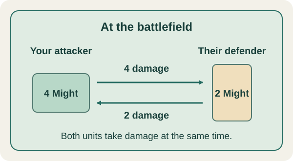

# Your first combat

::: tip Sourced note
Rules checked November 9, 2026.
:::

## How combat starts

Move a unit to a battlefield your opponent controls and occupies. In this example, you are the **attacker** and your opponent is the **defender**. Combat opens with a showdown, where both players have a chance to use certain cards and abilities.

## Deal damage with Might

After the showdown, if both sides still have units at the battlefield, each side adds up its units’ **current Might**. That total is the damage it assigns to the opposing units. Once both players finish assigning, the damage is dealt **at the same time**.

## Example of one unit on each side

You move a **4-Might** unit to a battlefield defended by a **2-Might** unit. Both players pass in the showdown, and no abilities change the example.

- The defender takes **4 damage**. That reaches its Might, so it is killed and goes to its owner’s Trash.
- Your attacker takes **2 damage** and survives. Clear that damage as combat resolves.
- Your unit stays sideways at the battlefield. You take control and conquer it if you haven’t scored it this turn.

If defenders survive a battle, any remaining attackers are normally **recalled**, which means they return to their base. If both sides lose all their units there, the battlefield is left without a controller.

Next lesson is [Scoring and winning](/basics/scoring).

[Previous lesson: Movement and battlefields](/basics/movement) · [Basics learning path](/basics/)

Official references

- [Riftbound Core Rules, October 9, 2026](https://cmsassets.rgpub.io/sanity/files/dsfx7636/news_live/5c7946f7c3b8c6e0faff85ab6dadc6d2e721ea94.pdf). Checked November 9, 2026.
  - Combat, the showdown, and attacker and defender roles: 316.7, 461–466.
  - Current Might, damage, and when a unit is killed: 142.4, 143.2, 467.1–467.2, and 323.4.
  - Healing, recall, control, and conquering: 456–458, 468.1, 468.5, and 471.1.
- [Riot’s Rules Hub](https://playriftbound.com/en-us/rules-hub/) and [Radiance patch notes](https://playriftbound.com/en-us/news/announcements/core-rules-radiance-patch-notes-effective-october-16-2026/). Checked November 9, 2026.

