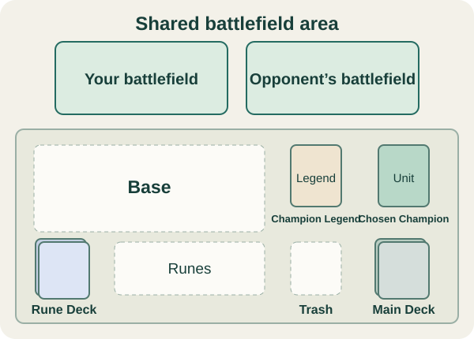

# Your first game

::: tip Sourced note
A scripted practice game with the Garen and Lux Proving Grounds decks. Rules checked November 9, 2026.
:::

## Set up Garen versus Lux

Use the [Game setup lesson](/basics/game-setup) with the battlefields supplied in these starter decks.

| | You | Your opponent |
| --- | --- | --- |
| Champion Legend | Might of Demacia | Lady of Luminosity |
| Chosen Champion | Garen, Commander | Lux, Illuminated |
| Battlefield | Trifarian War Camp | Startipped Peak |

For this practice game, you go first. Each player starts with **four cards**, including a **Daring Poro**, and keeps their opening hand. Make the plays shown below. Draw and channel as usual on each turn. Both players pass during each showdown, and both decline Startipped Peak’s optional extra rune when they hold it.

## Play your first unit and take a battlefield

On your first turn, channel two runes and draw one card. Exhaust the runes for **2 Energy** to play Daring Poro sideways in your base. Lux goes second, channels three runes, draws, and uses two runes to play a Daring Poro in their base.

On your second turn, ready your Poro and move it to **Trifarian War Camp**. After the showdown, you conquer it for **1 point**. Lux moves their Poro to **Startipped Peak** and conquers it for **1 point**.

## Play Garen, then attack on your next turn

On your third turn, hold Trifarian War Camp and reach **2 points**. After channeling, you have six ready runes, including an Order Rune. Exhaust all six and recycle one exhausted Order Rune to pay **6 Energy and 1 Order Power**. Play Garen from your Champion Zone and put him sideways in your base. Lux holds Startipped Peak and also reaches **2 points**.

On your fourth turn, ready Garen and hold Trifarian War Camp for your **third point**. Move Garen to Startipped Peak to fight Lux’s Poro. Garen has **5 Might** and the defending Poro has **2 Might**. After both players pass in the showdown, they deal damage to each other at the same time. The Poro goes to its owner’s Trash. Garen survives, his damage clears, and you conquer Startipped Peak for your **fourth point**.

## Hold both battlefields to win

Use this scorecard to follow the rest of the practice game. Lux leaves both battlefields alone for the remaining turns.

| Your turn | What you score | Score after your turn, you–Lux |
| --- | --- | --- |
| 4 | Hold Trifarian War Camp and conquer Startipped Peak. | **4–2** |
| 5 | Hold both battlefields. | **6–2** |
| 6 | Hold both battlefields again. | **8–2** |

You win in your sixth Beginning Phase. The Poro you played on turn one helped you score every turn from turn two onward by staying at Trifarian War Camp.

Next lesson is [Build your first deck](/basics/build-your-first-deck).

[Previous lesson: Scoring and winning](/basics/scoring) · [Basics learning path](/basics/)

Official references

- [Riftbound Core Rules, October 9, 2026](https://cmsassets.rgpub.io/sanity/files/dsfx7636/news_live/5c7946f7c3b8c6e0faff85ab6dadc6d2e721ea94.pdf). Checked November 9, 2026.
  - Opening hand, turn order, and the second player’s extra rune: 110–118 and 487.7.
  - Basic Runes, turn phases, and paying costs: 164.2, 315–317, and 357.1.
  - Playing and moving units, showdown, and combat: 143.4, 144, 348, 355.2.a, and 466–468.
  - Scoring and victory: 471–474 and 487.3.
- [Proving Grounds How to Play](https://uvsgames.com/wp-content/uploads/2025/11/OGS-ProvingGrounds-HowtoPlay-EN.pdf), “Setting Up the Game” and “Meet Your Legends.” Checked November 9, 2026 for the starter layout and both deck lists.
- [Riot’s Card Gallery](https://playriftbound.com/en-us/card-gallery/) and [Rules Hub](https://playriftbound.com/en-us/rules-hub/). Checked November 9, 2026. The named unit printings are Daring Poro (OGN-210/298) and Garen, Commander (OGS-013/024).

