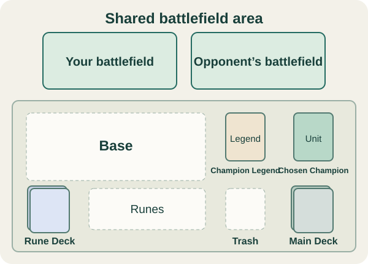

# Game setup

::: tip Sourced note
For a single-game 1v1 Duel. Rules checked November 9, 2026.
:::

## Lay out the table

1. Put your **Champion Legend** and **Chosen Champion** face up in their spaces.
2. Each player randomly selects one of their three battlefields. Reveal both selected battlefields together in the middle and set the rest aside. If you’re using the Proving Grounds starter setup, each deck supplies one battlefield.
3. Shuffle your remaining **Main Deck** and your **Rune Deck** separately. Put each pile face down in its own space.

*Your side of the table before the first turn, using the Proving Grounds mat layout.*

## Choose who goes first and draw

Use a fair random method you both agree on, such as a coin toss, to determine who goes first. Each player draws **four cards** from their Main Deck.

## Take your mulligan

A **mulligan** is your one chance to replace up to two cards from your opening hand. Starting with the first player, each player can do the following.

1. Set aside zero, one, or two cards from your hand.
2. Draw that many replacements from the top of your Main Deck.
3. **Recycle** the cards you set aside by putting them on the bottom of your Main Deck. If you recycle two, randomize their order.

For example, if you set aside two cards, keep the other two in your hand and draw two replacements. You still start with **four cards**.

The first player now takes their turn. The second player channels **one extra rune** on their first turn.

Next lesson is [A turn, step by step](/basics/turn-structure).

[Previous lesson: Runes, resources, and costs](/basics/runes-and-costs) · [Basics learning path](/basics/)

Official references

- [Riftbound Core Rules, October 9, 2026](/reference/core-rules). Checked November 9, 2026.
  - Champion cards, separate decks, first player, and starting hand: [110](/reference/core-rules#rule-110)–[116](/reference/core-rules#rule-116).
  - Mulligan order and recycling: [117](/reference/core-rules#rule-117)–[118](/reference/core-rules#rule-118) and [417.5](/reference/core-rules#rule-417-5).
  - Battlefields and second player’s extra rune for 1v1 (Duel): [487.4](/reference/core-rules#rule-487-4)–[487.7](/reference/core-rules#rule-487-7).
- [Proving Grounds How to Play](https://uvsgames.com/wp-content/uploads/2025/11/OGS-ProvingGrounds-HowtoPlay-EN.pdf), “Parts of a Deck” and “Setting Up the Game,” pp. 4 and 7. Checked November 9, 2026 for starter components and layout.
- [Riot’s Rules Hub](https://playriftbound.com/en-us/rules-hub/) and [Testing Start of Game Rules, October 15, 2026](https://playriftbound.com/en-us/news/organizedplay/testing-start-of-game-rules/). Checked November 9, 2026 for current rules and the scope of event playtests.

