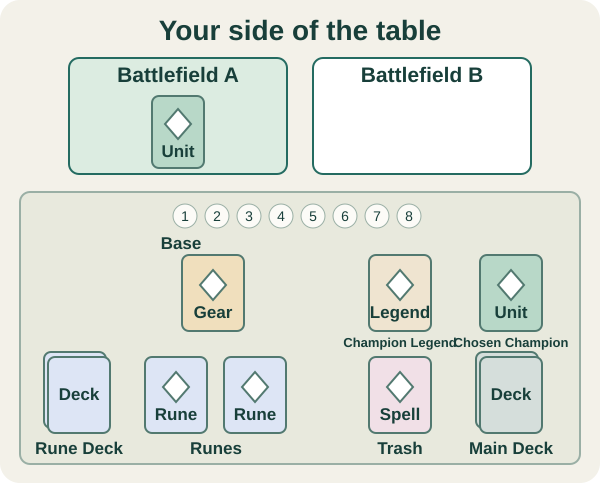

# Meet the cards

::: tip Sourced note
For a two-player game. Rules checked November 9, 2026.
:::

Start by recognizing what each kind of card does. You do not need to understand every symbol or instruction yet.

## Six kinds to recognize

| Card | Its role |
| --- | --- |
| **Unit** | A fighter you use to compete for battlefields. |
| **Spell** | Follow its instructions, then put it in its owner’s **Trash**, the pile for used spells and other discarded or destroyed cards. |
| **Gear** | Stays in play to help you through its card text. |
| **Rune** | Supplies **resources**, what you spend to pay for cards and other actions. |
| **Battlefield** | A location you compete to conquer and hold for points. |
| **Legend** | Starts in play and provides abilities—things its text lets it do. |

## Legend or champion unit?

Your **Champion Legend** is your starting legend. It helps determine which cards your deck can include.

A **champion unit** is still a unit: it can fight. Your **Chosen Champion** is a champion unit selected before the game, with one copy set aside to play later. It must match your legend’s champion character.

**The legend and the chosen champion are separate cards with different jobs.**

## See the actual cards

Select a card to see the full-size image. Start with the printed type label, then compare how the cards are laid out.

  <figure>
    
    <figcaption><strong>Unit · Garen, Commander</strong> The Champion Unit label identifies a fighter you can play.</figcaption>
  </figure>
  <figure>
    
    <figcaption><strong>Legend · Might of Demacia</strong> Garen’s Champion Legend starts in play. Compare its Legend label with Garen, Commander.</figcaption>
  </figure>
  <figure>
    
    <figcaption><strong>Spell · Falling Comet</strong> Read the Spell label and the instructions beneath the illustration.</figcaption>
  </figure>
  <figure>
    
    <figcaption><strong>Gear · Cloth Armor</strong> Look for Gear and Equipment. Equipment is gear that can attach to a unit.</figcaption>
  </figure>
  <figure>
    
    <figcaption><strong>Rune · Body Rune</strong> Look for Basic Rune. This card comes from the Rune Deck.</figcaption>
  </figure>
  <figure>
    
    <figcaption><strong>Battlefield · Trifarian War Camp</strong> Look for the Battlefield label and the sideways card layout.</figcaption>
  </figure>

*Card images © Riot Games. [Official Card Gallery](https://playriftbound.com/en-us/card-gallery/).*

## Which cards go together?

Your **Main Deck** is your stack of units, spells, and gear; the Chosen Champion starts set aside. Runes have their own **Rune Deck**. Your legend and battlefields start separately.

*The Proving Grounds layout puts your Rune Deck on the left and your Main Deck and Trash on the right. Your runes sit closer to you than your gear. The spell in the Trash has already been used.*

## Try recognizing the roles

Use the examples above or your own cards. Find a unit, a spell, and a rune. Explain which one fights, which one gives instructions to follow, and which one supplies resources. Use the table to check yourself.

Next lesson is [The play area](/basics/play-area), which shows where these cards belong on the table.

[Previous: Objective of the game](/basics/objective) · [Basics learning path](/basics/)

Official references

- [Proving Grounds How to Play](https://uvsgames.com/wp-content/uploads/2025/11/OGS-ProvingGrounds-HowtoPlay-EN.pdf), “Setting up the Game.” The diagrams adapt the starter mat layout.
- [Riot Games, Core Rules][core] — updated October 9, 2026; checked November 9, 2026.
  - Card categories and deck groups: [133.4](/reference/core-rules#rule-133-4)–[133.7](/reference/core-rules#rule-133-7). Base and battlefield placement: [107.1](/reference/core-rules#rule-107-1)–[107.2](/reference/core-rules#rule-107-2).
  - Units, gear, and Equipment: [140](/reference/core-rules#rule-140)–[152](/reference/core-rules#rule-152), especially [150](/reference/core-rules#rule-150); battlefield control: [190.4](/reference/core-rules#rule-190-4); combat: [461](/reference/core-rules#rule-461)–[468](/reference/core-rules#rule-468).
  - Spells and Trash: [157](/reference/core-rules#rule-157)–[158](/reference/core-rules#rule-158), [108.2](/reference/core-rules#rule-108-2).
  - Runes and resources: [161](/reference/core-rules#rule-161)–[163](/reference/core-rules#rule-163).
  - Battlefields and scoring: [170](/reference/core-rules#rule-170), [471](/reference/core-rules#rule-471)–[473](/reference/core-rules#rule-473).
  - Legends and their abilities: [174](/reference/core-rules#rule-174); Champion Legend and Chosen Champion: [103.2](/reference/core-rules#rule-103-2)–[103.3.a](/reference/core-rules#rule-103-3-a), [108.3](/reference/core-rules#rule-108-3), [176.1](/reference/core-rules#rule-176-1).
- [Official Rules Hub](https://playriftbound.com/en-us/rules-hub/) — checked for the current Core Rules on November 9, 2026.
- [Radiance patch notes](https://playriftbound.com/en-us/news/announcements/core-rules-radiance-patch-notes-effective-october-16-2026/) — effective October 16, 2026; and [Radiance Rules FAQ](https://playriftbound.com/en-us/news/organizedplay/radiance-rules-faq-and-clarifications/) — October 26, 2026. Checked November 9, 2026; this introduction uses ordinary card roles, not their special card interactions.

[core]: /reference/core-rules
