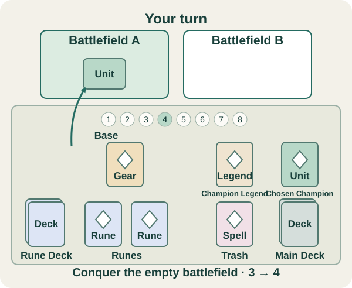

# Movement and battlefields

::: tip Sourced note
Rules checked November 9, 2026.
:::

## Make a Standard Move

A **Standard Move** is the move a unit can normally make during your Main Phase. Start with a **ready** unit. Turn it sideways to exhaust it, then move it to its destination.

| Starting location | Where it can normally go |
| --- | --- |
| Your base | Either battlefield in a Duel |
| A battlefield | Back to your base |

To move from one battlefield to another by this route, go back to your base first. You’ll need the unit to be ready again for the next move. Some cards allow other routes.

## Check who’s at the battlefield

- **Empty.** Moving there opens a **showdown**, a chance for players to use certain cards or abilities. If only your units are there when it ends, you take control. If you haven’t scored that battlefield this turn, you conquer it.
- **Opponent’s units are there.** Your units and theirs enter **combat**, which starts with a showdown.
- **You already control it.** You can move another unit there to help protect it. Adding a unit by itself earns no point.

## Example of taking an empty battlefield

You have **3 points** and a ready unit in your base. Exhaust it and move it to the empty Battlefield A. Both players pass without playing anything during the showdown. Your unit stays there, so you conquer Battlefield A and go to **4 points**. Leave the unit sideways at the battlefield.

If you move your last unit back to base, you normally give up control of that battlefield.

Next lesson is [Your first combat](/basics/combat).

[Previous lesson: Playing cards and using abilities](/basics/playing-cards) · [Basics learning path](/basics/)

Official references

- [Riftbound Core Rules, October 9, 2026](https://cmsassets.rgpub.io/sanity/files/dsfx7636/news_live/5c7946f7c3b8c6e0faff85ab6dadc6d2e721ea94.pdf). Checked November 9, 2026.
  - Standard Move, routes, and the cost to move: 144 and 415.
  - Establishing and maintaining control: 190.3–190.4.
  - Showdowns, empty battlefields, and combat: 316.7–316.8 and 344–348.
  - Conquering and the example point: 471.1–473.1.
- [Riot’s Rules Hub](https://playriftbound.com/en-us/rules-hub/) and [Radiance Rules FAQ](https://playriftbound.com/en-us/news/organizedplay/radiance-rules-faq-and-clarifications/). Checked November 9, 2026 for the current Core Rules and Standard Move clarifications.

