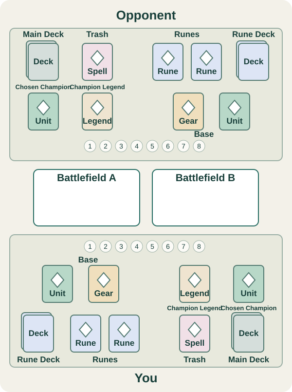
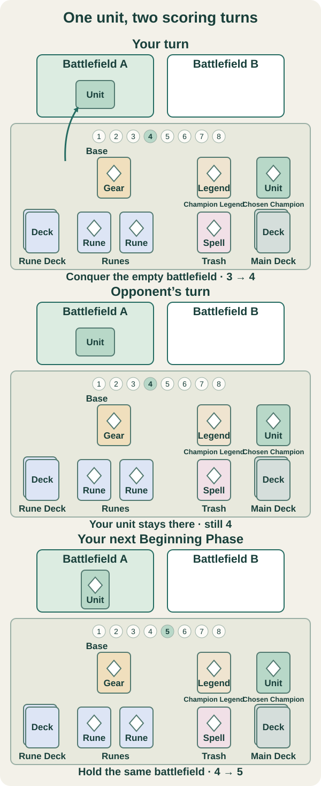

# Objective of the game

::: tip Sourced note
For a two-player game, called a **Duel**. Rules checked November 9, 2026.
:::

## The goal: reach 8 points

Your goal is to reach **8 points** before your opponent. This target is called the **Victory Score**.

## Battlefields are where you compete

A **battlefield** is a location that players compete to control. A Duel has **two battlefields**. When you control a battlefield, it is currently yours.

*Two Proving Grounds-style mats face each other. The two shared battlefields sit between the players.*

You normally earn points in two ways:

| Term | What it means | Usual reward |
| --- | --- | --- |
| **Conquer** | Gain control of a battlefield you have not already scored this turn. | 1 point |
| **Hold** | Keep control of a battlefield into your **Beginning Phase**, the opening part of your turn. | 1 point |

Here, **scoring a battlefield** means conquering or holding it. Each battlefield can be scored only once per turn by each player.

## An example: conquer, then hold

Suppose you have **3 points**, and no effects change how you earn points:

1. You move a **unit**, a card that can fight for you, from your base to an empty battlefield. It stays there and you take control, conquering it for **4 points total**.
2. Your opponent takes their turn, but you keep control of that battlefield.
3. During your next Beginning Phase, you hold it and gain another point. You now have **5 points**.

This gives you a reason both to take battlefields and to protect the ones you already control.

## What comes next?

Next lesson: [Meet the cards](/basics/meet-the-cards). We will return to scoring through more examples later. Detailed victory checks and final-point exceptions belong in [Advanced Rules](/advanced/).

[Back to the Basics learning path](/basics/)

Official references

- [Proving Grounds How to Play](https://uvsgames.com/wp-content/uploads/2025/11/OGS-ProvingGrounds-HowtoPlay-EN.pdf), “Setting up the Game.” The diagrams adapt the starter mat layout.
- [Riot Games, Core Rules][core] — updated October 9, 2026; winning goal: rules 194.2 and 487.3; battlefields: 487.4; play area: 107.1–107.2; moving and taking control: 144, 348.2; readying and holding: 315.1–315.2, 471–473; checked November 9, 2026.
- [Official Rules Hub](https://playriftbound.com/en-us/rules-hub/) — current document link checked November 9, 2026.
- [Radiance patch notes](https://playriftbound.com/en-us/news/announcements/core-rules-radiance-patch-notes-effective-october-16-2026/) — effective October 16, 2026; checked for relevant updates November 9, 2026.
- [Radiance Rules FAQ and Clarifications](https://playriftbound.com/en-us/news/organizedplay/radiance-rules-faq-and-clarifications/) — published October 26, 2026; checked for relevant clarifications November 9, 2026. No named-card interaction is used in this lesson.

[core]: https://cmsassets.rgpub.io/sanity/files/dsfx7636/news_live/5c7946f7c3b8c6e0faff85ab6dadc6d2e721ea94.pdf
