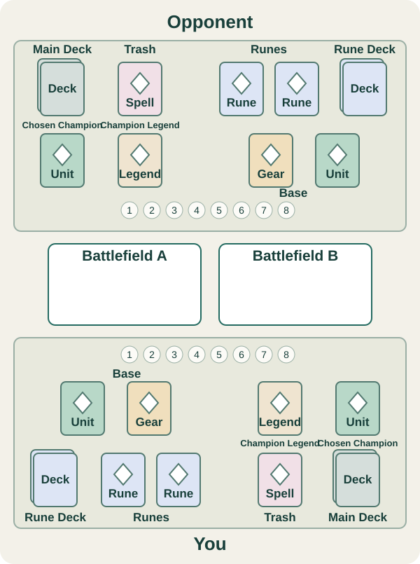
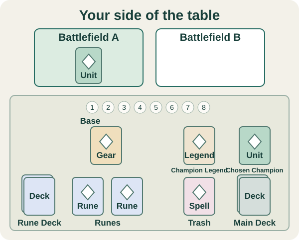

# The play area

::: tip Sourced note
For a two-player Duel. Rules checked November 9, 2026.
:::

## Start at the center

A **zone** is a place in the game with a purpose. The **Battlefield Zone** is the shared space for the two battlefields. Each player has their own **base**, where they keep gear, runes in play, and units that are at home.

## Find the spaces on your side

| Space | What goes there |
| --- | --- |
| **Base** | Your gear, runes in play, and units at home. |
| **Rune Deck** | Your face-down pile of runes. Runes come from here into your base. |
| **Main Deck** | The face-down pile you draw cards from. |
| **Hand** | The cards you hold. You can see their faces, and your opponent can count them. |
| **Trash** | Your used spells and cards that have been discarded or killed. Both players can see what’s there. |
| **Legend Zone** | The space where your Champion Legend starts face up. |
| **Champion Zone** | The space where your Chosen Champion starts face up, ready to be played when you can pay for it. |

*On the Proving Grounds mat, the Rune Deck is on the left. The Main Deck and Trash sit together on the right, below the two champion cards.*

## Follow a unit around the table

You **draw** a unit by taking the top card of your Main Deck into your hand. Later, you play it to your base. When it moves to a battlefield, place it beside that battlefield so both players can see where it is. If the unit is killed, put it in its owner’s Trash.

Next lesson is [Reading a unit: Might and card text](/basics/reading-a-unit).

[Previous lesson: Meet the cards](/basics/meet-the-cards) · [Basics learning path](/basics/)

Official references

- [Riftbound Core Rules, October 9, 2026][core]. Checked November 9, 2026.
  - Zones, bases, battlefields, and Legend Zone: [106](/reference/core-rules#rule-106), [107.1](/reference/core-rules#rule-107-1)–[107.2](/reference/core-rules#rule-107-2), [107.4](/reference/core-rules#rule-107-4).
  - Trash, Champion Zone, decks, hand, and visible cards: [108.2](/reference/core-rules#rule-108-2)–[108.5](/reference/core-rules#rule-108-5), [108.7](/reference/core-rules#rule-108-7), [109.1](/reference/core-rules#rule-109-1).
  - Drawing, playing to base, moving, and killed units: [414](/reference/core-rules#rule-414), [355.2.a](/reference/core-rules#rule-355-2-a), [144.4.a](/reference/core-rules#rule-144-4-a), [429.1](/reference/core-rules#rule-429-1).
  - Runes entering the base and Duel battlefields: [431](/reference/core-rules#rule-431), [487.4](/reference/core-rules#rule-487-4).
- [Proving Grounds How to Play](https://uvsgames.com/wp-content/uploads/2025/11/OGS-ProvingGrounds-HowtoPlay-EN.pdf), “Setting Up the Game,” p. 7. Reference for the mat illustration, checked November 9, 2026.
- [Riot’s Rules Hub](https://playriftbound.com/en-us/rules-hub/), [Radiance patch notes](https://playriftbound.com/en-us/news/announcements/core-rules-radiance-patch-notes-effective-october-16-2026/), and [Radiance Rules FAQ](https://playriftbound.com/en-us/news/organizedplay/radiance-rules-faq-and-clarifications/). Checked for relevant updates November 9, 2026.

[core]: /reference/core-rules
